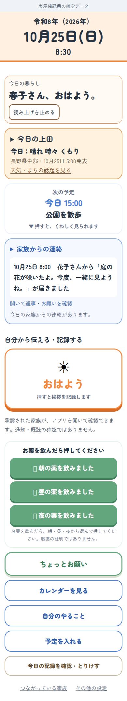

# 本人ホーム：暮らし・家族の連絡・自分の記録

2026年10月25日。基準main: `5979a85a69eee7136cfc46a3d4a019787f957733`。

## 目的と今回の範囲

本人が記録をする前に、自分の予定・上田の天気・家族の言葉を確認できるようにする。既存の本人ホームの配置と表示だけを整理し、別アプリ化・認証変更・通知追加・保存先移行は行わない。

完成条件は、(1)日付・天気・予定が上部でまとまる、(2)今日の家族の言葉が記録ボタンより先に見つかる、(3)保存結果と取り消しの入口が対応し、既存の共有・返信・取消条件を変えない、の3点。

## 変更内容

- 日付・挨拶に続けて、上田の天気、今日／次の予定、家族からの連絡、自分の記録の順に配置。今日の予定と次の予定が同じ1件の場合に重複させない既存処理を維持。
- 「家族からの連絡」の閉じた見出し内にも、今日の最新の連絡を日時・送り主付きで表示。開くと見出し内の本文を隠し、既存の本文・返信ボタン・お願い・履歴を表示する。新着で勝手に開閉しない。
- 過去日の連絡、家庭／アカウント切替時の連絡を見出し内に残さない。通信確認待ち・失敗の案内も維持。読むだけでは返信や既読の記録を作らない。
- 「自分から伝える・記録する」で記録操作を区切る。「家族へ報告」という見出しを外し、共有先・通知や既読の保証ではないことは引き続き明示。
- 保存成功時の既存の取消入口に「押し間違えたときは、記録を選んで取り消せます」を添え、枠で見つけやすくする。入口を押すだけでは削除せず、自分の今日の記録を選び、確認して取り消す。
- 表示項目の設定、本人が共有相手を確認する入口、利用終了・同意取り消し、読み上げ、家族の画面は維持。Service Workerのキャッシュ名をv73へ更新。

## 検証

- 回帰確認：配置の検査を先に変更し、修正前には「家族からの連絡は記録ボタンより先に見つけられる」で失敗、修正後に成功。
- `node .github/scripts/check-basics.mjs`：44/44成功。
- `.github/workflows/basic-checks.yml`に列挙された65のテストコマンドをローカルで実行し、すべて成功（ワークフロー自体は変更していない）。`tests/ueda-today.test.mjs`も成功。
- 本番HTMLと実際の表示・返信関数を使うDOM検査：見出し内の本文、開閉時の重複防止、読むだけでは書き込まないこと、HTMLとして解釈しないこと、過去日の非表示、家庭切替時の消去、返信先の一致を確認。
- 押し間違いの既存検査：保存待ち・失敗・二重押し・家庭切替・日替わり、自分の今日の記録だけの取消、削除確認とフォーカスを確認。
- Chromium 133で、実際のHTML/CSS・地域欄の描画コードを使い、320/390/1024px幅を確認。全幅で横はみ出しなし。文字200%でも横はみ出しなし。見出しをクリックして本文・返信欄に進み、閉じると見出し内の本文に戻ることを確認。
- 上のブラウザー確認は架空の家族・予定・固定予報を使用。外部通信を遮断し、本番Firebase・LINEを使っていない。画面見本の絵文字は検査環境の代替字体で、端末ごとの描画は未確認。

## 残る確認と公開状態

iPhone／Android実機、LINE内ブラウザーの表示・音声、本番データの保存や通知は未確認。上記は本番Firebaseとの通し試験ではない。家族の気づきやすさ・本人の継続利用が改善するかは、実際の利用者による確認が必要。

この変更は確認用の下書きPRとして保存する。マージ・本番反映・実際のLINE送信は行っていない。GitHub上の最終コミットに対するCI結果はPR側で確認する。
